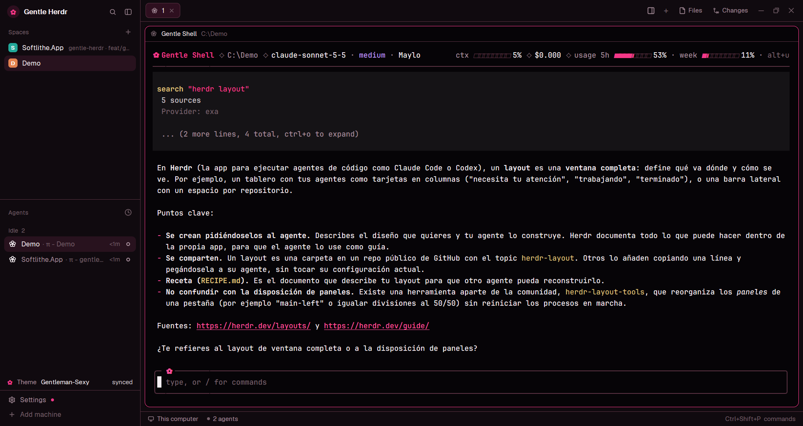

# Gentle Herdr

The herdr app window, unchanged in structure, in the colors of Gentle Shell. It is herdr's own expanded-sidebar layout with a "Gentle Herdr" brand, a flower in place of the generic agent icon, a right-panel toggle, and a small row in the sidebar that keeps herdr's colors in step with the theme you pick in Gentle Shell.

## What you see

The same window as herdr's default layout, with no system title bar:

1. **The sidebar**, 268px, `chrome` color: the brand row, then Spaces and Agents lists, then a 30px **theme row**, then Settings and Add machine.
2. **The brand row**: a 24px circle with a pink `✿`, the text "Gentle Herdr", then search and the sidebar toggle.
3. **The theme row**, 30px: a pink `✿`, "Theme", the active Gentle Shell theme name, and a state on the right: `synced`, `synced (built-in)`, `waiting` or `error: <reason>`. When the sidebar is the narrow rail (under 160px, like `workspace-chrome` decides) only the flower is shown, in the accent color when synced, muted when waiting and in the blocked color on error.
4. **The tab bar**, 42px, over the work area. On the right, left to right: a **right-panel toggle** (herdr's `panel-right` icon, shown pressed while the panel is open), the new-tab `+`, then the Files and Changes buttons.
5. **The pane**, one rounded terminal frame (radius 10) with a pink focus border (`accent`). The Gentle Shell agent shows a flower, not the generic robot, in the Agents list, the tab pill and the pane header.
6. **The right panel**, hidden until opened: Files and Changes, 368px.
7. **The status bar**, 28px, after the sidebar.

Colors come from the `gentle-shell` theme. Shipped values (used until the mod syncs, and for fields a Pi theme does not define): base `#1a1218`, terminal `#140a12`, rail `#100a0e`, surfaces `#20161e`, `#241822`, `#342230`, text `#f6eff3`, muted `#a78e9b`, accent `#f095c8`, done `#b4e7c7`, blocked `#ff718f`.

## How it behaves

- Every panel except the brand row and the tab bar is a shipped herdr mod (`spaces`, `agents`, `pane`, `files`, `changes`, `workspace-status`), so a mod the person replaces keeps working here.
- The `gentle-theme` mod reads `theme` from `~/.gentle-shell/agent/settings.json` every 500 ms, finds that Pi theme (custom file, or the built-in `dark` and `light`), derives a herdr theme and rewrites `themes/gentle-shell.json` only when the result changed. The Pi theme file is re-read when the name changes and every 5 seconds.
- Built-in `dark` and `light` are embedded in the mod (Pi stores them inside its package, as `okhsl(...)` colors); on a light background the foreground colors flip to dark. The Gentle Shell theme `system` keeps the shipped Gentle palette.
- The toggle runs `layout.show` or `layout.hide` on the `panel` node, like the Files and Changes buttons, and does not change the per-space memory of which panel is open.
- Agent statuses (working, blocked, done, idle) use the theme's `working`, `blocked`, `done` and `idle` colors.
- Missing or invalid files never crash the mod; the theme row shows `waiting` or `error` instead.

## Built from

- **The layout** (`layouts/gentle-herdr.json`): the node tree of herdr's `main` layout, plus root `theme: "gentle-shell"`, root `preview: "layouts/gentle-herdr.svg"`, one added block `gentle-theme-status` (30px, mod `gentle-theme`) between `sidebar-lists` and `sidebar-footer`, and three mod swaps: brand and footer use `gentle-chrome`, the tab bar uses `gentle-tabs`. No color is written as hex.
- **The theme** (`themes/gentle-shell.json`): `background`, `foreground`, `selection`, `cursor`, 16 `ansi` colors and `colors` overrides by herdr color name. It is the fallback and is rewritten by the mod.
- **`mods/gentle-chrome/`**: a copy of herdr's `workspace-chrome` (herdr-app 0.1.12) whose only change is the brand row (flower circle and "Gentle Herdr" instead of the herdr logo and name).
- **`mods/gentle-tabs/`**: a copy of herdr's `tabs` whose only change is the panel toggle button before `+`; it uses `panel-right.svg`.
- **`mods/gentle-theme/`**: `mod.json` is `{ "place": "none" }`. `derive.js` is a pure function `derive(piTheme, base)` that maps Pi theme variables to herdr colors (table in its header comment) and parses `okhsl()` like Pi does. `builtin.js` holds the built-in `dark` and `light`. `main.js` uses `home()`, `appHome()`, `readTextFile()`, `writeTextFile()`, `theme()` and a 500 ms `cx.timer.every`. `flower.svg` is the icon.
- **`programs.json`**: one entry, `gentle-shell`, that gives the agent a tinted flower (`mods/gentle-theme/flower.svg`, color `#f095c8`, tile `#342230`). It is the person's file, so merge it into theirs instead of replacing it.

## Watch out

- The `gentle-theme` mod **reads files outside its folder** (`~/.gentle-shell/agent/settings.json`, and the Pi theme file under `~/.gentle-shell/agent/themes`, `~/.pi/agent/themes` or `gentle-pi/themes`) and **writes `themes/gentle-shell.json`** in the herdr home. It runs no programs and uses no network.
- `gentle-chrome` and `gentle-tabs` are clones, so herdr no longer updates them in this layout. Compare them with `workspace-chrome` and `tabs` after a herdr upgrade.
- `programs.json` lives in the herdr home and a layout cannot ship it. Add the `gentle-shell` entry to the person's own file (create it if missing). Without it the flower becomes the generic robot again; nothing else breaks.
- Confirmed on herdr-app 0.1.12 (Windows): the layout loads with no errors, `herdr-app check` passes for the three mods, `home()` resolves the Gentle Shell and Pi paths, herdr applies a rewritten `themes/gentle-shell.json` live, and switching Gentle Shell to `light` and `dark` was reflected in herdr in 374 ms and 218 ms.
- The derived colors follow the Gentle Shell theme, so they differ from the shipped palette. `Gentleman-Cute` has the website accent `#f095c8`; `Gentleman-Sexy` has `#f43888`.
- `ansi0`, `accent_foreground` and `solid_foreground` keep shipped values on dark themes and are computed on light ones.
- The embedded `dark` and `light` are copies of Pi 1.4.0 and drift if a later Pi changes them.
- `themes/gentle-shell.json` is overwritten by the mod; edits made by hand are lost.
- `preview.png` is captured with `herdr-app shot` from a window without private content.

## Done when

- `npm test` passes (`node --test tests/theme/ tests/layout/ tests/programs/`).
- `herdr-app check` passes for `mods/gentle-theme`, `mods/gentle-chrome` and `mods/gentle-tabs`.
- After `layout.switch {name: "gentle-herdr"}`, the sidebar brand reads "Gentle Herdr", the theme row says `synced`, and the right-panel toggle opens and closes the panel.
- Changing the theme in Gentle Shell (including `light` and `dark`) changes the colors of herdr within about a second.
- `ctrl-shift-l` goes back to the person's own layout.
